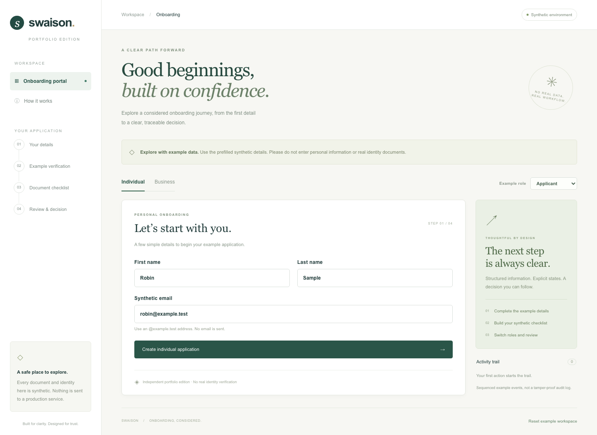

# Swaison Onboarding Portal

A standalone portfolio edition of an individual and corporate onboarding workflow.
Built with **Vue 3, TypeScript, Vite, Express and Zod**, using synthetic data and an
independent local API. No keys, private packages, database or external services are
required.



## What you can explore

- Individual registration and simulated code verification.
- Corporate registration, addresses and up to three authorized signatories.
- A synthetic document checklist with attach/remove actions, without file uploads.
- Submission, requested changes, resubmission and example approval.
- Explicit applicant/reviewer selection and a sequenced activity trail.
- Browser-isolated, resettable in-memory workspaces and revision conflict handling.

The role selector illustrates workflow permissions. **It is not authentication.**
There is no identity verification, real account opening, compliance determination,
email delivery, payment processing or production integration.

## Why this repository exists

This edition reworks selected onboarding concepts from the historical Swaison
application into a small, reviewable system. Its implementation, UI, contracts,
example fixtures and tests were independently authored for this repository. It is
not a complete migration or a source mirror of the private production application.
The original application and its integrations remain separate and private.

The code emphasizes explicit domain transitions, validation at the HTTP boundary,
atomic rejected commands, optimistic revision checks and reproducible examples.

## Run locally

Requires Node.js **22.13+ (22.x), or 24+** and npm.

```sh
git clone https://github.com/MargusHemlex/swaison-portfolio.git
cd swaison-portfolio
npm ci
npm run dev
```

Open [127.0.0.1:3108](http://127.0.0.1:3108). Start with the prefilled examples.
The synthetic verification code is **424242**. Email fields accept only
`@example.test`; company identifiers use `SYN-1001` format. Do not enter personal data.

To serve a built client locally:

```sh
npm run build
npm start
```

`PORT=3109 npm start` changes the local port. The server deliberately binds only to
`127.0.0.1`. No environment file or service account is needed. Installations and
browser downloads require network; the running application uses only its local server.

## Verify

```sh
npm run check
npx playwright install chromium
npm run test:e2e
```

`check` runs ESLint, Vue/TypeScript checks, a client build, domain/HTTP tests and a
limited publication check. Playwright runs against the built client and real local
API. CI executes these checks plus a dependency audit. To update the README image:
`UPDATE_SCREENSHOT=1 npm run test:e2e` after building.

## Engineering guide

| Topic                                         | Guide                                |
| --------------------------------------------- | ------------------------------------ |
| Components, boundaries and state              | [Architecture](docs/ARCHITECTURE.md) |
| Commands, responses and error codes           | [API contract](docs/API.md)          |
| Reproducible individual and business journeys | [Examples](examples/README.md)       |
| Private/public separation and data handling   | [Privacy and scope](docs/PRIVACY.md) |
| Verification evidence and limits              | [Verification](docs/VERIFICATION.md) |
| Remaining publication gate                    | [Release checklist](docs/RELEASE.md) |
| Changes and contributions                     | [Contributing](CONTRIBUTING.md)      |

## Limits

State disappears when the server restarts. Workspaces expire after an hour of
inactivity and have a maximum of 200 accepted events before reset; a server accepts
up to 128 active workspaces. A browser cookie is an isolation mechanism, not a user
account. Review notes are illustrative and the event trail is mutable in memory,
not tamper-proof evidence. No real files exist behind the synthetic PDF filenames.

This is a local portfolio application. Public hosting needs separate authentication,
access, persistence, abuse and deployment decisions; this repo is not connected to
the production deployment. It remains private pending the owner's final review.

## License

New application code, UI and authored synthetic examples in this repository are
provided under the [MIT license](LICENSE). Installed dependencies retain their own
licenses. No historical source files, proprietary packages, documents, logos or
binary assets were imported from the private application.
