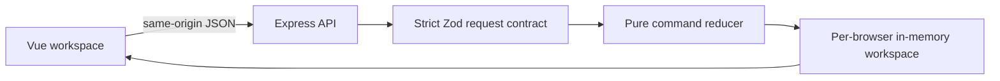

# Architecture

`src/` contains the interface, reusable person/address/checklist/review components
and an API composable. `shared/contracts.ts` defines request types and limits.
`shared/workflow.ts` applies commands to a clone and returns a new state only on
success. `server/app.ts` validates the request, compares its expected revision and
commits the reducer result synchronously. `server/index.ts` mounts the client and
listens on loopback; development uses Vite middleware on the same origin.

## State transitions

Individual: `awaiting-verification` → `draft` → `submitted` → `approved`.
The synthetic code is checked before leaving verification. Company applications
start in `draft`. A reviewer can move `submitted` to `changes-requested`, which
reopens editing and submission. Approved/submitted applications cannot be edited.

Individuals need identity/address checklist items. Companies need registration and
operating addresses, at least one signatory, and incorporation/address items.
Document metadata comes from fixed, synthetic filenames; no upload route exists.
Each accepted command appends a numbered event without copying submitted fields
into the event detail. Reset clears application data and events, then appends its
own event while advancing the revision to prevent stale commands from succeeding.

## HTTP and concurrency boundary

All commands carry `expectedRevision`. A stale value returns 409. The client
refreshes after failed mutations, including a timeout where a command may already
have committed. Its ten-second timeout is a client bound, not an undo mechanism.

The API accepts loopback Host values, rejects foreign Origin mutation requests,
serves no CORS headers, bounds JSON bodies to 16 KiB and uses strict schemas.
These are local application boundaries, not an Internet authentication design.
Applicant/reviewer headers are deliberately user-selectable example roles.

## Workspace lifetime

A random HttpOnly, SameSite=Strict cookie selects a workspace. It is scoped to
`/api` and is not a JWT. Server state expires after one hour of inactivity; the
cookie itself has a one-hour lifetime from creation. Browser tabs share that cookie.
Separate browser contexts have separate workspaces. There are at most 128 sessions,
200 events per workspace before reset, two applications and three signatories.
The single-process design has no durable persistence or cross-instance consistency.

## Implementation provenance

This is an independent implementation of selected historical workflow concepts.
The legacy backend, production adapters, settings, migrations, package references,
credentials, original assets and Git history are not included. The interface uses
system fonts and CSS, so it makes no font, image or CDN requests at runtime.
